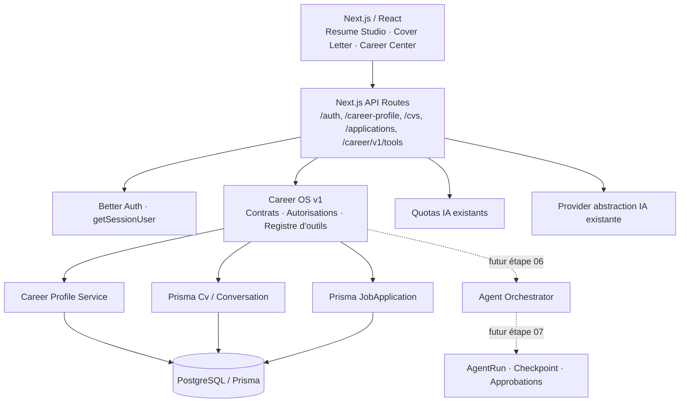

# CVComet 2.0 · Étape 01 — Architecture & contrats Career OS

**Date :** 24 octobre 2026 · **Périmètre :** interfaces, outils *read-only* existants, frontières de domaine, autorisation, transport v1, télémétrie sûre et stratégie d'idempotence.

## 1. Architecture cible (monolithe modulaire, sans microservices)



La couche IA actuelle reste fonctionnelle. **Un orchestrateur autonome, les écritures agentiques et les missions persistantes ne sont pas livrés à l'étape 01.** Aucun outil non implémenté n'est présenté comme actif.

## 2. Modules et responsabilités

| Chemin | Responsabilité | Interdiction |
|---|---|---|
| `src/lib/career-os/contracts.ts` | Version publique, nom des outils, classification des effets, enveloppe de réponse | Aucune dépendance base/IA |
| `src/lib/career-os/policy.ts` | Autorisation par identité serveur, refus par défaut | Ne jamais croire un rôle ou propriétaire dans le prompt |
| `src/lib/career-os/tool-registry.ts` | Validation d'entrée et adaptateurs Prisma en lecture | Aucun `create/update/delete`, HTTP externe ou admin cross-account |
| `src/lib/career-os/http.ts` | Enveloppe de réponse, erreurs sûres, versions, request ID | Ne pas renvoyer stack, prompts ou erreurs fournisseur |
| `src/lib/career-os/telemetry.ts` | Journaux d'état/durée corrélés, sans données personnelles | Ne pas enregistrer CV, messages, PII, tokens, clés |
| `src/lib/career-os/idempotency.ts` | Contrats de clé et de fingerprint pour les futures écritures | La validation de clé seule ne garantit **pas** l'idempotence |
| `src/app/api/career/v1/tools/route.ts` | Endpoint authentifié du catalogue et de 4 outils de lecture | Aucune exécution de tool d'écriture |

Réutilisations volontaires : `getSessionUser`, `careerProfileContext`, `getCareerProfile`, quotas IA et Prisma singleton. Pas de dépendance NPM supplémentaire, pas de nouveau mécanisme d'authentification.

## 3. Contrat API v1 (nouveau, sans modification des réponses héritées)

**GET `/api/career/v1/tools`** retourne les outils actifs et prévus pour une session authentifiée.

**POST `/api/career/v1/tools`**, avec `Content-Type: application/json`, corps limité à 8 KiB :

```json
{"apiVersion":"v1","tool":"list_my_resumes","input":{"limit":10}}
```

Réponse (les éléments sont des résumés sélectionnés depuis les enregistrements de l'utilisateur) :

```json
{"apiVersion":"v1","requestId":"<server-uuid>","data":{"tool":"list_my_resumes","result":[]}}
```

Erreurs stables : `401 UNAUTHORIZED`, `400 VALIDATION` / `UNSUPPORTED_API_VERSION`, `404 TOOL_NOT_AVAILABLE` / `RESOURCE_NOT_FOUND`, `413 TOO_LARGE`, `415 INVALID_TYPE`, `500 INTERNAL_ERROR`. Les réponses incluent les en-têtes `Cache-Control: private, no-store`, `X-CVComet-API-Version: v1` et `X-CVComet-Request-ID`.

### Registre d'outils exécutables

| Outil | Entrée | Sortie (propriétaire uniquement) |
|---|---|---|
| `get_my_profile` | `{}` | Profil professionnel projeté ; aucun mot de passe, paiement, code de vérification |
| `list_my_resumes` | `{limit?: 1..30}` | ID, titre, révision, modèle et date |
| `get_my_resume` | `{resumeId: UUID}` | Données du CV si la conversation parente appartient au demandeur |
| `list_my_applications` | `{limit?: 1..30}` | Résumés des candidatures |

Les entrées sont strictes (`z.object(...).strict()`) : pas de `userId`, `ownerId`, `admin`, `approved` ajoutés. L'ADMIN ne peut pas employer ces tools pour traverser vers un autre utilisateur. La recherche du CV porte le filtre de propriétaire **dans la requête SQL**, pas après lecture d'un CV étranger.

### Outils catalogués, mais indisponibles

`analyze_job`, `draft_resume_changes`, `draft_cover_letter`, `submit_application`, `send_application_email` ne peuvent pas être appelés à cette étape. Les demandes non listées renvoient `TOOL_NOT_AVAILABLE`. Envoyer une candidature ou contacter un employeur exigera un workflow distinct avec consentement explicite sur l'action exacte et revérification d'identité au moment de l'exécution.

## 4. Stratégie d'idempotence et événements

- **Aujourd'hui :** les quatre tools sont en lecture seule. Ils ne requièrent pas de reçus de mutations. La clé d'idempotence et la comparaison de fingerprints sont définies/testées, **mais ne sont pas branchées à un protocole d'écriture durable**.
- **À introduire avant un agent avec actions (étapes 06–07) :** table PostgreSQL à contrainte unique `(userId, operationKey)` avec `payloadHash`, `state`, `result`, `expiresAt` et timestamps. Réservation atomique dans une transaction ; rejet 409 si une clé est réutilisée avec une autre entrée ; replay uniquement après résultat *committed* ; les échecs et délais doivent être rejouables sans double effet.
- **Approbations :** un jeton d'approbation serveur éphémère, lié à `actorId`, `toolId`, `payloadHash`, date d'expiration et consommation unique. Aucun texte d'IA ne peut constituer une approbation.
- **Événements :** préférer au début un outbox PostgreSQL transactionnel (si une notification/délivrance externe devient nécessaire). Ne pas introduire Kafka, Redis ou une flotte de microservices sans raison mesurée.

## 5. Compatibilité, sécurité, observabilité

- Aucun endpoint historique renommé ni réponse JSON ancienne modifiée ; nouvelles fonctionnalités sous `/api/career/v1/`.
- Les garde-fous phase 00 restent en place, notamment middleware anti-origine, auth, quotas IA et protection Stripe.
- Chaque requête de la nouvelle API produit un ID corrélé et une trace structurée minimale (outil générique, issue et durée), sans détails de candidature ni prompt.
- Pas de cache partagé pour les résultats personnels.
- Les appels IA de l'assistant historique restent indépendants : **ce n'est pas encore un assistant avec tool-calling autonome**.

## 6. Tests et limites

```bash
npm run test:cvcomet:baseline
npm run typecheck
npm run build
```

La première commande couvre les tests phase 00 + les nouveaux tests purs de politique, version, accès et gardes statiques du registre. Les deux dernières doivent être rejouées après installation de dépendances et application des migrations phase 00 en staging.

**Non validable dans cette session :** véritables requêtes HTTP Next.js avec cookies Better Auth, Prisma Client généré, migrations PostgreSQL réelles, compilation complète et endpoints de fournisseur IA. Aucun verrouillage des dépendances n'a été inventé.

## 7. Critères avant l'étape 02

1. `npm run test:cvcomet:baseline` passe ; syntaxe TS/TSX valide.
2. ZIP cumulatif contient tout l'ensemble des fichiers modifiés en phases 00–01 et seulement eux, aux chemins d'origine.
3. Un utilisateur connecté ne peut lire ni le profil, ni le CV, ni les candidatures d'un autre utilisateur via les nouveaux outils ; les actions externes n'ont pas de chemin d'exécution.
4. Exécuter ultérieurement les tests staging réels de DB/auth avant déploiement public.
